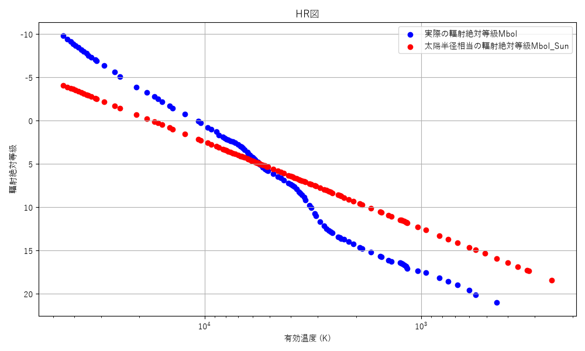
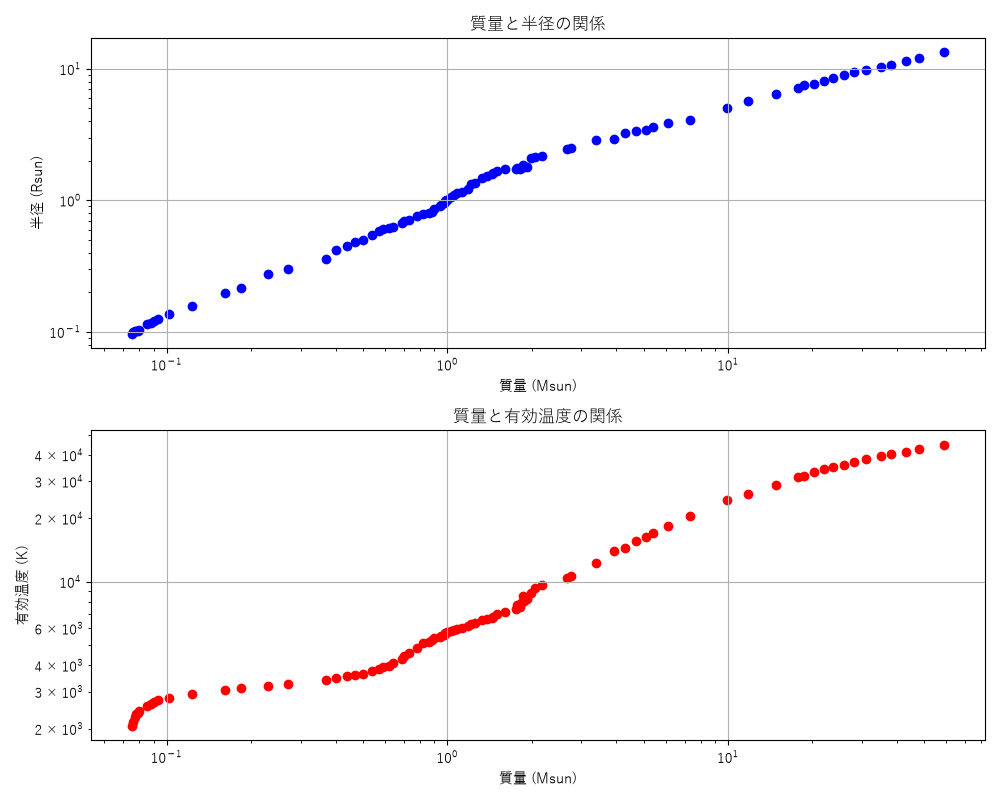
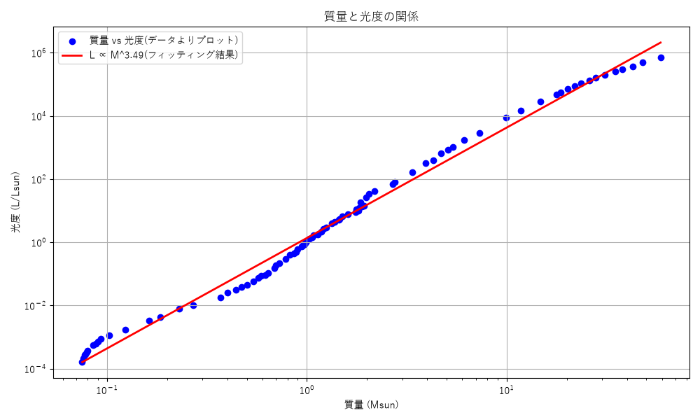

# 22.恒星のHR図

## 主系列星は、高温なほど大きく、低温なほど小さい！
以下をHR図に図示した

　・実際の輻射絶対等級Mbol

　・恒星の半径に太陽半径を仮定し、有効温度に対する輻射絶対等級を計算Mbol_sun

### 発見
　・高温：実際の等級は、太陽半径を仮定した場合の計算上の等級よりも、かなり小さい（明るい）

　　→実際の恒星はもっともっと大きいということ

　・低温：実際の等級は、太陽半径を仮定した場合の計算上の等級よりも、かなり大きい（位）

　　→実際の恒星はもっともっと小さいということ

　***恒星は、温度が高いほど、大きいということ！***

## 温度が高くて大きいとはどういうこと？恒星の質量と、大きさ（半径）／温度の関係を図示する
　データから、質量と半径の関係、質量と有効温度の関係をプロットしてみた。

### 発見
 ・重い星ほど、半径は大きいし、温度も高い

### 考察
　・なぜ、重い星ほど大きく、温度も高いのか？

　・直感的には、重いほど重力が強く、圧縮されて小さくなることも考えられるが・・・

　・イメージとしては、

　　　・質量が大きいと、重力が強く、強く圧縮される

　　　・圧縮されると、中心温度が上がる

　　　・温度が上がると、圧力が上がる

　　　・重力と圧力が平衡する半径が大きくなる

　　　　　→よって、***重い星ほど大きく、温度も高い***

# 質量と光度の関係　L ∝ M^3～4 は本当か？グラフで確かめてみる
　太陽質量／太陽光度との比でグラフ化する

## 結果
　・図の赤線は、データよりプロットした点を１次関数にフィッティングしたものであり、これの傾きは3.49。

　・***一般に、ここの傾きは3.5程度と言われており、かなり良い数字が得られている***
